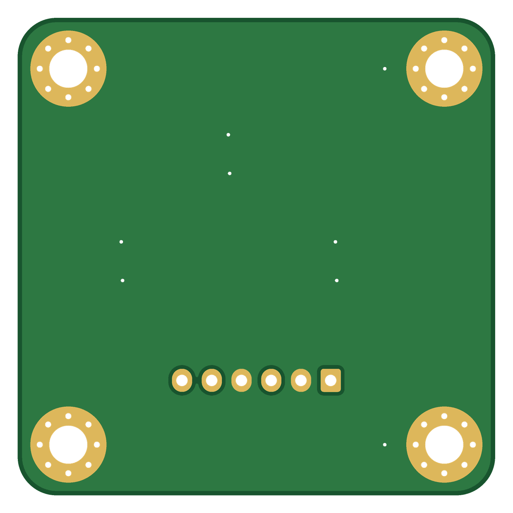

# Cartes électroniques (KiCad) — version V1.9.3

| Carte | Rôle | Composants principaux |
|---|---|---|
| `LM_puissance/` | Shield enfiché sur la NUCLEO-L476RG (CN7 / CN10) : commande des 4 bobines et acquisition | 2 × L293D (ponts X et Y), 4 × shunt 0,1 Ω 1 W + INA240A1, filtres RC des entrées ADC, régulateur L7805, protection d'entrée (P-MOS IRF4905, TVS SMBJ15A, fusible), bornier 12 V |
| `LM_plateau/` | Plateau de mesure de position, relié à la carte de puissance par un connecteur JST-XH | 3 × capteur à effet Hall DRV5055A4 (H1, H2, H3) |

Chaque dossier contient le projet (`.kicad_pro`), le schéma (`.kicad_sch`), le routage (`.kicad_pcb`)
et la **nomenclature** (`nomenclature.csv`, affichée sous forme de tableau par GitHub).
Les schémas sont aussi en PDF, lisibles sans KiCad, dans [`Docs/schemas`](../Docs/schemas).

## Composants à commander

| Carte | Nomenclature | Pièces |
|---|---|---|
| Puissance | [`LM_puissance/nomenclature.csv`](LM_puissance/nomenclature.csv) | 71 pièces (69 composants + 2 supports DIP-16) |
| Plateau | [`LM_plateau/nomenclature.csv`](LM_plateau/nomenclature.csv) | 7 composants |

À prévoir en plus, hors cartes :
- 1 carte NUCLEO-L476RG ;
- 1 câble JST-XH 6 points entre les deux cartes, câblé 1 vers 1 (2 boîtiers XHP-6 et 12 contacts, ou câble pré-serti) ;
- 1 alimentation 12 V continue (la carte est protégée par un fusible 2 A temporisé) ;
- 8 vis M3 et entretoises (4 trous de fixation par carte) ;
- les 4 bobines et les aimants (voir le point ouvert ci-dessous).

### Carte de puissance — dessus

### Carte de puissance — dessous (vue retournée)

### Plateau — dessus et dessous (vue retournée)

 

## Fabrication

Les fichiers Gerber de la version V1.9.3 sont dans la Release **`pcb-v1.9.3`** du dépôt.
Pour les régénérer après une modification : dans l'éditeur de PCB, **Fichiers → Fichiers de fabrication → Gerbers**.

## Points ouverts

- Les positions de H1, H2 et H3 sur le plateau sont provisoires.
- La partie physique n'est pas encore documentée : bobines (nombre de spires, fil, R, L), aimants
  (type, dimensions), objet en lévitation. Ce sont ces grandeurs qui fixent les valeurs de
  `Firmware/LM_V2/Core/Inc/LM_config.h`.
- Les valeurs de puissance (pistes, shunts) sont dimensionnées pour le L293D : à revoir en cas de passage à un pont MOSFET.

## Historique

| Version | Changement |
|---|---|
| V1.9.3 | Sérigraphie allégée : seuls restent les repères utiles au montage. Cuivre, vernis et perçages identiques à la V1.9.2 |
| V1.9.2 | Allègement des vias de masse, DRC sans erreur |
