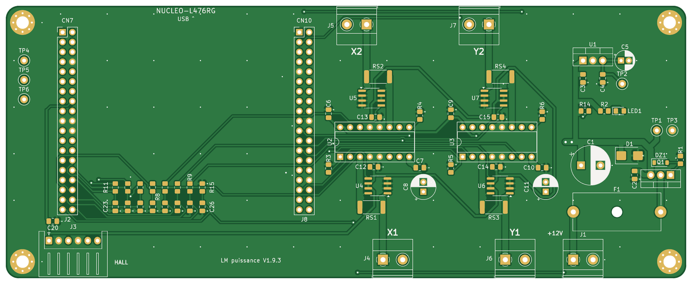
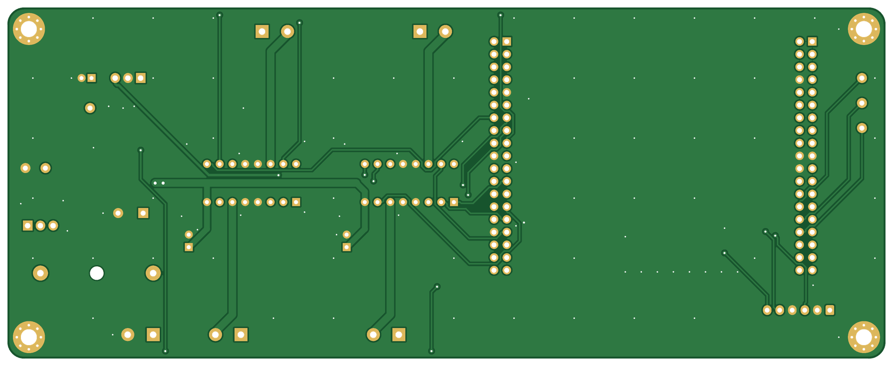
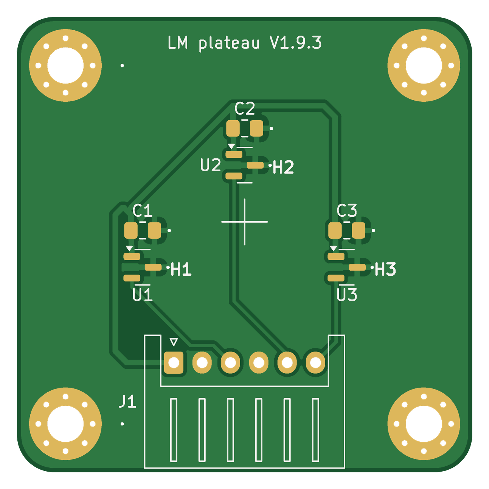

# Cartes électroniques (KiCad) — version V1.9.3

| Carte | Rôle | Composants principaux |
|---|---|---|
| `LM_puissance/` | Shield enfiché sur la NUCLEO-L476RG (CN7 / CN10) : commande des 4 bobines et acquisition | 2 × L293D (ponts X et Y), 4 × shunt 0,1 Ω 1 W + INA240A1, filtres RC des entrées ADC, régulateur L7805, protection d'entrée (P-MOS IRF4905, TVS SMBJ15A, fusible), bornier 12 V |
| `LM_plateau/` | Plateau de mesure de position, relié à la carte de puissance par un connecteur JST-XH | 3 × capteur à effet Hall DRV5055A4 (H1, H2, H3) |

Chaque dossier contient le projet (`.kicad_pro`), le schéma (`.kicad_sch`) et le routage (`.kicad_pcb`).

### Carte de puissance — dessus

### Carte de puissance — dessous (vue retournée)

### Plateau — dessus et dessous (vue retournée)

 

## Fabrication

Les fichiers Gerber de la version V1.9.3 sont dans la Release **`pcb-v1.9.3`** du dépôt.
Pour les régénérer après une modification : dans l'éditeur de PCB, **Fichiers → Fichiers de fabrication → Gerbers**.

## Points ouverts

- Les positions de H1, H2 et H3 sur le plateau sont provisoires.
- Les valeurs de puissance (pistes, shunts) sont dimensionnées pour le L293D : à revoir en cas de passage à un pont MOSFET.

## Historique

| Version | Changement |
|---|---|
| V1.9.3 | Sérigraphie allégée : seuls restent les repères utiles au montage. Cuivre, vernis et perçages identiques à la V1.9.2 |
| V1.9.2 | Allègement des vias de masse, DRC sans erreur |
