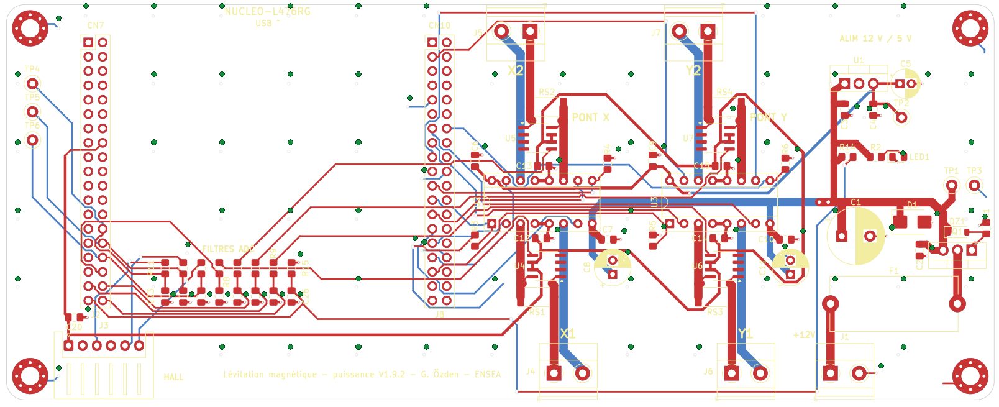
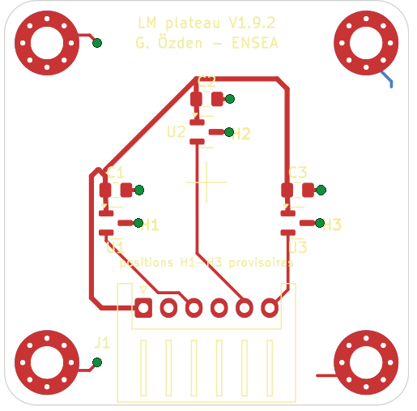

# Lévitation magnétique 2 axes — ENSEA

Un objet aimanté lévite au-dessus d'un plateau. Sa position latérale (X, Y), naturellement
instable, est mesurée par 3 capteurs à effet Hall et stabilisée en temps réel par 4 bobines
pilotées par une carte NUCLEO-L476RG.

**Objectif phase 1 : lévitation stable d'un objet d'au moins 800 g pour le 15 décembre 2026.**

| Carte de puissance (shield Nucleo) | Plateau de mesure |
|---|---|
|  |  |

## Contenu du dépôt

| Dossier | Contenu |
|---|---|
| [`Hardware/`](Hardware) | Les 2 cartes KiCad : puissance et plateau |
| [`Firmware/`](Firmware) | Le projet STM32CubeIDE `LM_V2` (boucle de lévitation à 5 kHz) |
| [`Outils/`](Outils) | `lm_outil.py` : lecture du log série, calcul de L, ω₀ et β, courbes |
| [`Docs/`](Docs) | Documents du projet |

## Versions

Les versions figées sont dans les [Releases](../../releases) :

| Version | Contenu |
|---|---|
| `firmware-v2.0` | Projet STM32CubeIDE complet (zip) et outil PC |
| `pcb-v1.9.2` | Fichiers Gerber des 2 cartes, à envoyer au fabricant |

## État au 15 novembre 2026

- **Cartes V1.9.2** : vérification DRC sans erreur, prêtes à être commandées.
- **Firmware V2** : compile sans avertissement et a été validé en simulation (modèle instable
  2 axes + L293D + ADC). Il n'a pas encore été testé sur la maquette.
- **Valeurs provisoires** dans `Firmware/LM_V2/Core/Inc/LM_config.h` : R et L des bobines,
  ω₀ et β de chaque axe. Elles seront mesurées avec l'outil PC une fois les cartes reçues.

## Démarrer

- **Cartes** : KiCad 7 ou plus récent, ouvrir `Hardware/LM_puissance/LM_puissance.kicad_pro`
  ou `Hardware/LM_plateau/LM_plateau.kicad_pro`.
- **Firmware** : STM32CubeIDE, **File → Open Projects from File System** → `Firmware/LM_V2`,
  puis **Project → Clean** et **Ctrl+B**. Mode d'emploi détaillé : `Firmware/LM_V2/LISEZMOI.txt`.
- **Outil PC** : voir [`Outils/README.md`](Outils/README.md).

## Règles de travail

- Une seule branche `main`. Pour une modification risquée, créer une branche courte
  (ex. `pcb-v2`), puis la fusionner dans `main` par une pull request et la supprimer.
- Pas de zip ni de fichiers générés dans le dépôt : les versions figées vont dans les Releases.
- Les fichiers gardent toujours le même nom (pas de numéro de version dans le nom) :
  l'historique Git conserve toutes les versions.
- Une tâche = une *Issue*, assignée à un membre de l'équipe.

## Équipe

Gökay, Dylan, Subhen, Elias — ENSEA.
